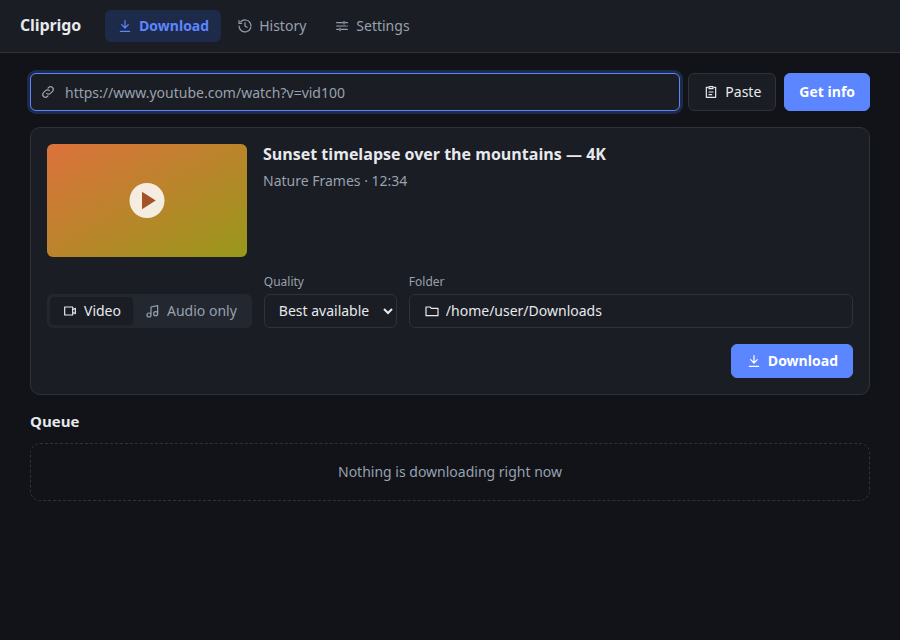
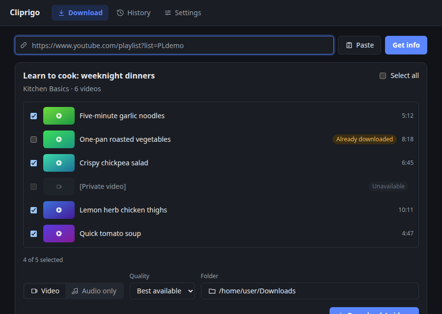
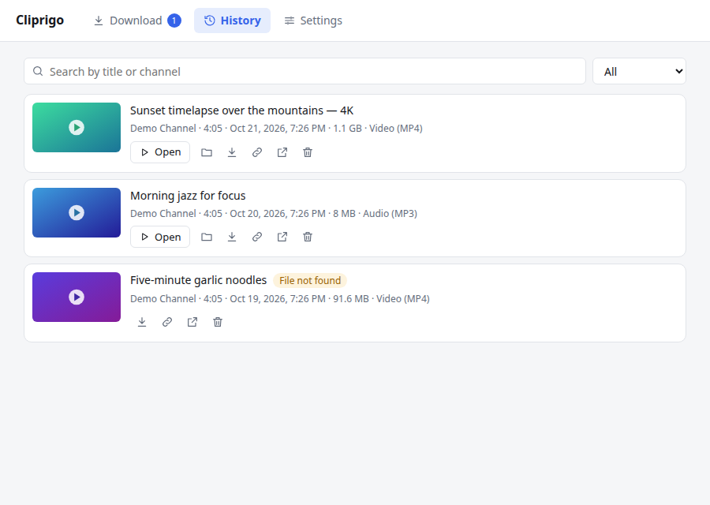
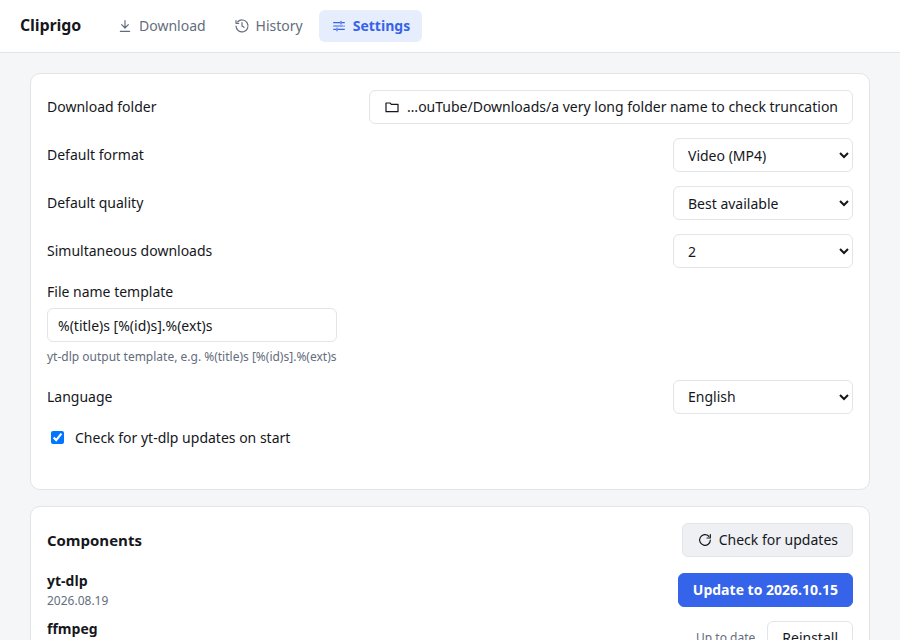

<p align="center">
  
</p>

<h1 align="center">Cliprigo</h1>

<p align="center">Download YouTube videos and keep a history of everything you saved.</p>

<p align="center">
  <a href="https://github.com/hightemp/cliprigo/actions/workflows/build.yml"></a>
  <a href="https://github.com/hightemp/cliprigo/releases/latest"></a>
  <a href="https://github.com/hightemp/cliprigo/releases"></a>
  
  <a href="LICENSE"></a>
</p>

<p align="center"><b>English</b> | <a href="README.ru.md">Русский</a></p>

A small cross-platform desktop app for downloading YouTube videos, with a history of everything you've downloaded so nothing gets lost.

Cliprigo is a friendly front end for [yt-dlp](https://github.com/yt-dlp/yt-dlp). It downloads and updates yt-dlp, ffmpeg and Deno by itself, so there is nothing to install by hand.



## Features

- **Paste a link, pick a format, download.** Best quality MP4, a specific resolution (4K, 1080p, 720p…), or audio only as MP3/M4A.
- **Codec choice with a hint on where it plays:** Auto, H.264 (opens in any player), AV1 (smallest files) or VP9. Plain HTTPS formats are preferred over slow HLS streams.
- **Playlists and channels.** Pick the videos you want; ones you already have are marked and unchecked.
- **Download queue** with a configurable number of parallel downloads, live progress, speed and time left. Canceling removes partial files.
- **History** of every download with search, a status filter, thumbnails that work offline, and quick actions: open the file, show it in its folder, copy the link, retry, download again.
- **Duplicate warning** before downloading a video that's already in your history or queue.
- **Keeps itself working.** yt-dlp is checked for updates on start, since YouTube changes often.
- English and Russian interface, light and dark theme following the system.

| Playlist                                      | History                                     | Settings                                      |
| --------------------------------------------- | ------------------------------------------- | --------------------------------------------- |
|  |  |  |

## Install

Download the installer for your system from the [Releases](https://github.com/hightemp/cliprigo/releases) page:

| System  | File                                       |
| ------- | ------------------------------------------ |
| Windows | `.msi` or `-setup.exe` (x64, ARM64)        |
| macOS   | `.dmg` (Apple Silicon, Intel)              |
| Linux   | `.AppImage`, `.deb` or `.rpm` (x64, ARM64) |

On first launch Cliprigo downloads yt-dlp, ffmpeg and Deno (about 200 MB) from their official GitHub releases and verifies their checksums.

### Unsigned builds

Releases are not code-signed yet, so the system warns on first launch:

- **Windows:** "Windows protected your PC" → **More info** → **Run anyway**.
- **macOS:** **System Settings** → **Privacy & Security** → **Open Anyway**.
  Or in a terminal: `xattr -dr com.apple.quarantine /Applications/Cliprigo.app`.
- **Linux:** nothing to do.

## Where things are stored

| Data                                  | Windows                                     | macOS                                                 | Linux                                       |
| ------------------------------------- | ------------------------------------------- | ----------------------------------------------------- | ------------------------------------------- |
| History, settings, yt-dlp/ffmpeg/Deno | `%APPDATA%\com.hightemp.cliprigo`           | `~/Library/Application Support/com.hightemp.cliprigo` | `~/.local/share/com.hightemp.cliprigo`      |
| Logs                                  | `%LOCALAPPDATA%\com.hightemp.cliprigo\logs` | `~/Library/Logs/com.hightemp.cliprigo`                | `~/.local/share/com.hightemp.cliprigo/logs` |

Downloads go to your Downloads folder by default; change it in Settings.

## Troubleshooting

- **"YouTube asked to confirm you're not a bot".** YouTube distrusts some networks (VPNs, hosting providers, some proxies). Try again later or from another network.
- **A download suddenly fails for every video.** YouTube may have changed something; open Settings → **Check for updates** and update yt-dlp.
- **Logs:** Settings → **Open logs folder**.

## Development

Requires Node.js 22+, pnpm 10+, Rust stable and the [Tauri prerequisites](https://v2.tauri.app/start/prerequisites/).

```sh
pnpm install
pnpm tauri dev      # run in development mode
pnpm tauri build    # build installers
pnpm lint           # prettier + svelte-check + vitest
pnpm ui:preview     # UI scenarios in headless Chrome with screenshots (needs Google Chrome)
```

Rust tests: `cargo test` in `src-tauri`. End-to-end tests against real YouTube are opt-in:
`cargo test live_ -- --ignored --test-threads=1`.

Application icons use [assets/cliprigo-app-icon.png](assets/cliprigo-app-icon.png), generated with `image_gen` using the [saved prompt](assets/cliprigo-app-icon.prompt.txt). Run `pnpm icons` to regenerate the PNG, ICO and ICNS assets in `src-tauri/icons/cliprigo/` and the browser favicon.

If `HTTP_PROXY` is set in your environment, the app adds `localhost`, `127.0.0.1` and `::1` to `NO_PROXY` on start (`src-tauri/src/net_env.rs`), so `tauri dev` works without extra setup.

Stack: Tauri 2, Svelte 5, SQLite. Product requirements and the task plan (in Russian): [PRD.ru.md](PRD.ru.md), [TASKS.ru.md](TASKS.ru.md).

## Disclaimer

Cliprigo does not bundle yt-dlp, ffmpeg or Deno; it downloads them from their official releases. Only download content you have the right to, and respect the terms of service of the sites you use.

## License

[MIT](LICENSE)
