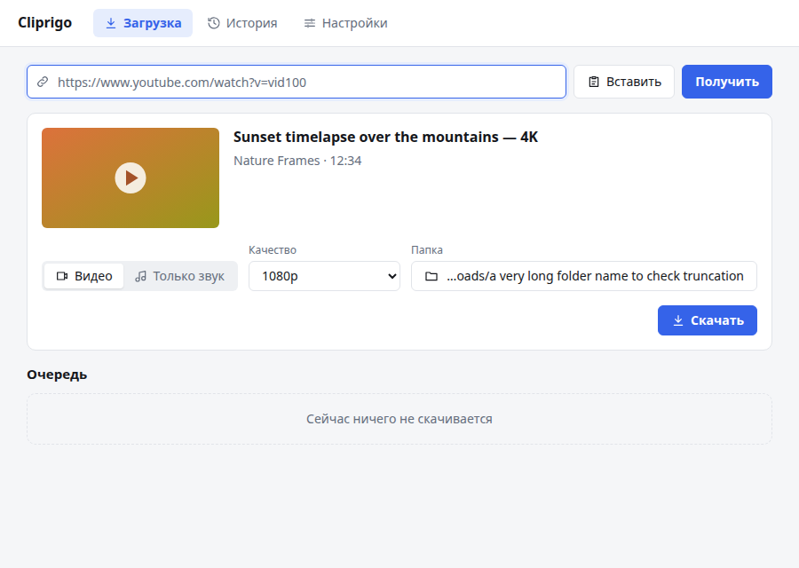
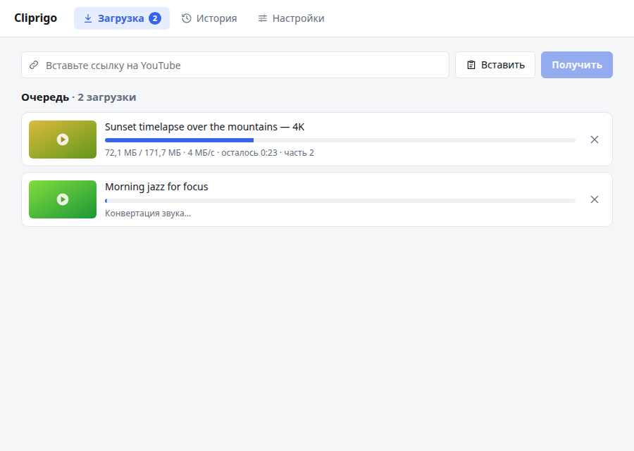
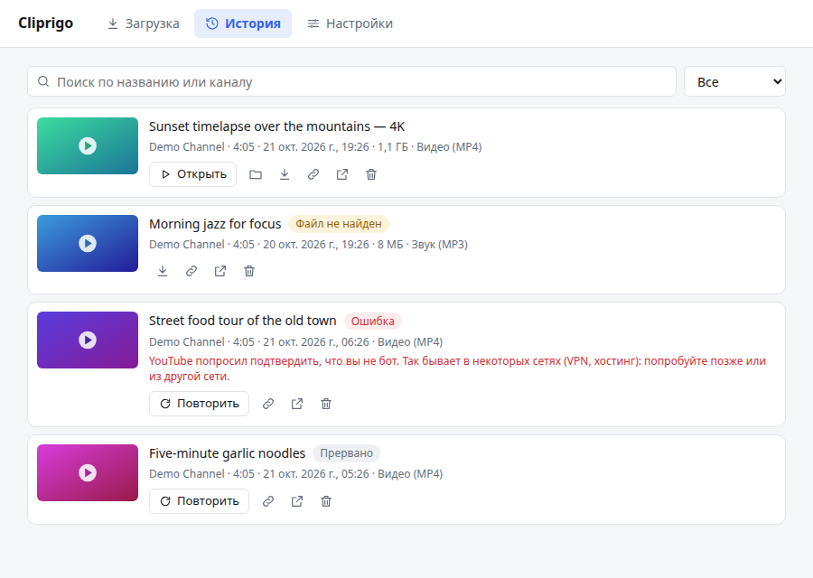

# Cliprigo

[English](README.md) | **Русский**

Небольшое кроссплатформенное приложение для скачивания видео с YouTube. Ведёт историю всего скачанного, чтобы ничего не потерялось.

Cliprigo — удобная оболочка над [yt-dlp](https://github.com/yt-dlp/yt-dlp). Приложение само скачивает и обновляет yt-dlp, ffmpeg и Deno, вручную ничего ставить не нужно.



## Возможности

- **Вставил ссылку, выбрал формат, скачал.** MP4 в лучшем качестве, конкретное разрешение (4K, 1080p, 720p…) или только звук в MP3/M4A.
- **Плейлисты и каналы.** Можно выбрать нужные видео; то, что уже скачано, помечается и не выбирается.
- **Очередь загрузок** с настраиваемым числом параллельных загрузок, прогрессом, скоростью и оставшимся временем. При отмене недокачанные файлы удаляются.
- **История** всех загрузок: поиск, фильтр по статусу, превью, которые работают без сети, и быстрые действия — открыть файл, показать в папке, скопировать ссылку, повторить, скачать снова.
- **Предупреждение о дубле**, если видео уже есть в истории или в очереди.
- **Сам поддерживает себя в рабочем состоянии.** yt-dlp проверяет обновления при запуске: YouTube меняется часто.
- Интерфейс на русском и английском, светлая и тёмная тема по системе.

| Очередь                                   | История                                     |
| ----------------------------------------- | ------------------------------------------- |
|  |  |

## Установка

Скачайте установщик для своей системы на странице [Releases](https://github.com/hightemp/cliprigo/releases):

| Система | Файл                                        |
| ------- | ------------------------------------------- |
| Windows | `.msi` или `-setup.exe` (x64, ARM64)        |
| macOS   | `.dmg` (Apple Silicon, Intel)               |
| Linux   | `.AppImage`, `.deb` или `.rpm` (x64, ARM64) |

При первом запуске Cliprigo скачивает yt-dlp, ffmpeg и Deno (около 200 МБ) из официальных релизов на GitHub и проверяет их контрольные суммы.

### Неподписанные сборки

Релизы пока не подписаны, поэтому при первом запуске система покажет предупреждение:

- **Windows:** «Windows защитила ваш компьютер» → **Подробнее** → **Выполнить в любом случае**.
- **macOS:** **Системные настройки** → **Конфиденциальность и безопасность** → **Открыть всё равно**.
  Или в терминале: `xattr -dr com.apple.quarantine /Applications/Cliprigo.app`.
- **Linux:** ничего делать не нужно.

## Где хранятся данные

| Данные                                 | Windows                                     | macOS                                                 | Linux                                       |
| -------------------------------------- | ------------------------------------------- | ----------------------------------------------------- | ------------------------------------------- |
| История, настройки, yt-dlp/ffmpeg/Deno | `%APPDATA%\com.hightemp.cliprigo`           | `~/Library/Application Support/com.hightemp.cliprigo` | `~/.local/share/com.hightemp.cliprigo`      |
| Логи                                   | `%LOCALAPPDATA%\com.hightemp.cliprigo\logs` | `~/Library/Logs/com.hightemp.cliprigo`                | `~/.local/share/com.hightemp.cliprigo/logs` |

По умолчанию файлы сохраняются в папку «Загрузки», её можно сменить в настройках.

## Если что-то не работает

- **«YouTube попросил подтвердить, что вы не бот».** YouTube не доверяет некоторым сетям (VPN, хостинг, часть прокси). Попробуйте позже или из другой сети.
- **Вдруг перестали скачиваться все видео.** Скорее всего, YouTube что-то поменял: откройте «Настройки» → **Проверить обновления** и обновите yt-dlp.
- **Логи:** «Настройки» → **Открыть папку логов**.

## Разработка

Нужны Node.js 22+, pnpm 10+, Rust stable и [системные зависимости Tauri](https://v2.tauri.app/start/prerequisites/).

```sh
pnpm install
pnpm tauri dev      # запуск в режиме разработки
pnpm tauri build    # сборка установщиков
pnpm lint           # prettier + svelte-check + vitest
pnpm ui:preview     # UI-сценарии в headless Chrome со скриншотами (нужен Google Chrome)
```

Rust-тесты: `cargo test` в `src-tauri`. Сквозные тесты с настоящим YouTube запускаются отдельно:
`cargo test live_ -- --ignored --test-threads=1`.

Если в окружении задан `HTTP_PROXY`, приложение само добавляет `localhost`, `127.0.0.1` и `::1` в `NO_PROXY` при запуске (`src-tauri/src/net_env.rs`), так что `tauri dev` работает без настройки.

Стек: Tauri 2, Svelte 5, SQLite. Требования и план: [PRD.ru.md](PRD.ru.md), [TASKS.ru.md](TASKS.ru.md).

## Дисклеймер

Cliprigo не содержит yt-dlp, ffmpeg и Deno, а скачивает их из официальных релизов. Скачивайте только тот контент, на который у вас есть права, и соблюдайте условия использования сервисов.

## Лицензия

[MIT](LICENSE)
